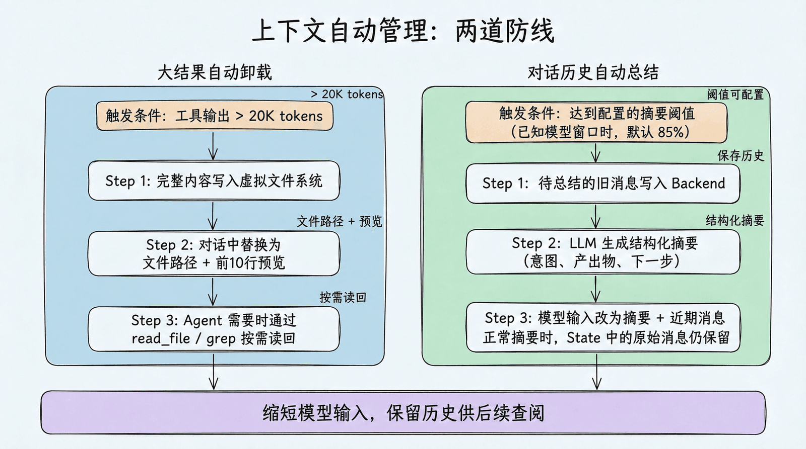
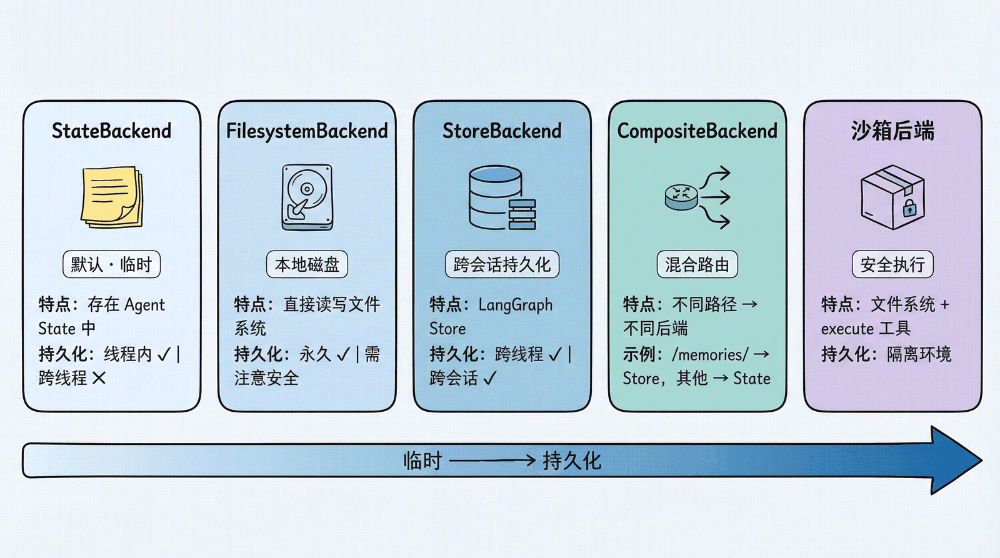
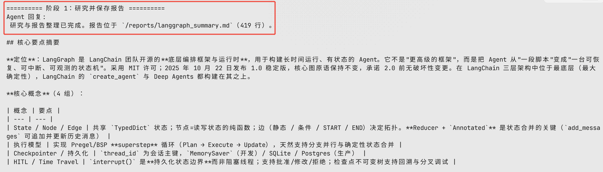
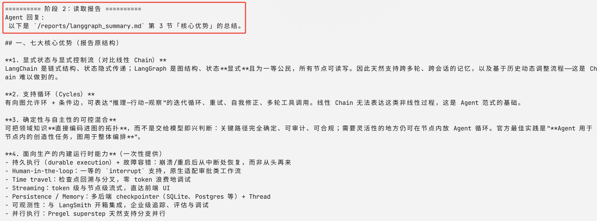
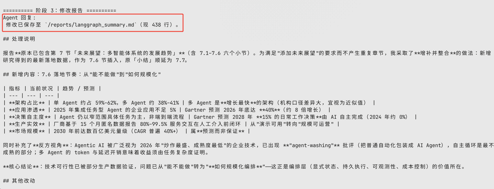

# 让成果留在文件里——Deep Agents虚拟文件系统学习与实践

## 学习材料

https://datawhalechina.github.io/deepagents-in-action/chapters/ch03-virtual-filesystem/

## 核心概念

### 内置文件系统工具

Deep Agents 当前提供 7 个内置文件工具。

| 工具         | 用途                                                         | 类比                           |
| ------------ | ------------------------------------------------------------ | ------------------------------ |
| `ls`         | 列出目录中的文件和元信息（大小、修改时间）                   | 打开文件夹看看有什么           |
| `read_file`  | 读取文件内容，支持偏移量和限制条数；原生支持多模态格式（图片、视频、音频、PDF/PPT） | 翻开某份资料阅读               |
| `write_file` | 创建文件，或完整覆盖已有文件                                 | 写一份新的备忘录或重写整份草稿 |
| `edit_file`  | 对已有文件做精确字符串替换                                   | 用红笔修改文档                 |
| `delete`     | 删除文件或目录                                               | 清理不再需要的资料             |
| `glob`       | 按模式匹配查找文件（如 `**/*.py`）                           | 在文件柜中按标签找             |
| `grep`       | 搜索文件内容，按字面量匹配；支持内容输出和计数               | 全文检索                       |

### 上下文自动管理



### 可插拔的存储后端



- **后端选择指南**

| 场景           | 推荐后端                         | 理由              |
| -------------- | -------------------------------- | ----------------- |
| 学习和实验     | StateBackend（默认）             | 零配置，自动清理  |
| 本地编程助手   | FilesystemBackend                | 直接操作项目文件  |
| 需要跨会话记忆 | CompositeBackend                 | 混合临时 + 持久化 |
| 需要执行代码   | 沙箱后端                         | 安全隔离          |
| 生产部署       | StoreBackend 或 CompositeBackend | 持久化 + 可伸缩   |

## 示例实践

> 具体的文件存到哪里，由**后端（Backend）**决定。Deep Agents 的后端是**可插拔的**——你可以根据场景选择不同的存储策略。

### StateBackend（默认）：临时存储

#### （1）功能说明

文件存在 LangGraph 的 Agent State 中。特点：

- 同一个对话线程内**持久化**（多轮对话不丢失）
- 对话结束后**丢失**（换一个 thread 就没了）
- 主 Agent 和子 Agent **共享**文件

适合场景：大多数情况下的默认选择，Agent 的”草稿纸”。

#### （2）示例代码

- **backend可不填，默认就是 StateBackend，不需要显式指定**
- **必须带 checkpointer，同一 thread_id 的下一轮才能读到上一轮写入的文件**
- **MemorySaver 用 configurable.thread_id 分开保存各自的 state，包括 StateBackend 写进去的文件**

```python
import os
from pathlib import Path

from dotenv import load_dotenv
from langchain_openai import ChatOpenAI
from deepagents import create_deep_agent
from deepagents.backends import StateBackend
from langgraph.checkpoint.memory import MemorySaver
from pydantic import SecretStr

load_dotenv(Path(__file__).resolve().parents[1] / ".env")

model = ChatOpenAI(
    model=os.environ.get("OPENAI_MODEL", "deepseek-v4.1-flash"),
    api_key=SecretStr(os.environ["OPENAI_API_KEY"]),
    base_url=os.environ["OPENAI_BASE_URL"],
)

# StateBackend 把文件放在当前对话的 state 里。
# 必须带 checkpointer，同一 thread_id 的下一轮才能读到上一轮写入的文件。
agent = create_deep_agent(
    model=model,
    # backend=StateBackend(),  # 默认就是 StateBackend，不需要显式指定
    checkpointer=MemorySaver(),
    system_prompt="你是文件助手。写文件用 write_file，读文件用 read_file。文件不存在时直接说明，不要编造内容。",
)

# 对话编号，MemorySaver 用 configurable.thread_id 分开保存各自的 state，包括 StateBackend 写进去的文件
thread_a = {"configurable": {"thread_id": "thread-a"}}
thread_b = {"configurable": {"thread_id": "thread-b"}}

agent.invoke(
    {"messages": [{"role": "user", "content": "把这句话写到 /notes.txt：hello-from-thread-a"}]},
    thread_a,
)
same_thread = agent.invoke(
    {"messages": [{"role": "user", "content": "读取 /notes.txt，只回复文件内容。"}]},
    thread_a,
)
other_thread = agent.invoke(
    {"messages": [{"role": "user", "content": "读取 /notes.txt，只回复文件内容。"}]},
    thread_b,
)

print("thread-a:", same_thread["messages"][-1].content)
# thread-a: hello-from-thread-a

print("thread-b:", other_thread["messages"][-1].content)
# thread-b: 文件 /notes.txt 不存在（根目录下没有任何文件），因此没有内容可以回复。

print("thread-a state files:", sorted((same_thread.get("files") or {})))
# thread-a state files: ['/notes.txt']
```

#### （3）执行结果

- **正常执行**

```
thread-a: hello-from-thread-a

thread-b: 文件 /notes.txt 不存在（根目录下没有任何文件），因此没有内容可以回复。

bnthread-a state files: ['/notes.txt']
```

- **不带checkpoint**

```
thread-a: 根目录下也没有任何文件，所以 /notes.txt 确实不存在（根目录当前是空的）。
如果你记得文件名或所在目录不同，告诉我具体路径，我再试一次。

thread-b: /notes.txt 不存在，无法读取。

thread-a state files: []
```

### FilesystemBackend：本地磁盘

#### （1）功能说明

```python
from deepagents.backends import FilesystemBackend

agent = create_deep_agent(
    model=model,
    backend=FilesystemBackend(root_dir=".", virtual_mode=True)
)
```

文件直接读写**本地文件系统**。特点：

- `root_dir` 指定 Agent 可访问的根目录；相对路径会被解析为绝对路径（`Path(root_dir).resolve()`），`"."` 即当前工作目录
- `virtual_mode=True` 启用路径沙箱（阻止 `..`、`~` 及越界的绝对路径），**强烈建议开启**；若为默认的 `virtual_mode=False`，即使设了 `root_dir` 也不提供任何越界保护
- 文件修改是**永久的、不可逆的**

适合场景：本地开发 CLI（编程助手）、CI/CD 流水线。

#### （2）示例代码

```python
import os
import tempfile
from pathlib import Path

from dotenv import load_dotenv
from langchain_openai import ChatOpenAI
from deepagents import create_deep_agent
from deepagents.backends import FilesystemBackend
from langgraph.checkpoint.memory import MemorySaver
from pydantic import SecretStr

load_dotenv(Path(__file__).resolve().parents[1] / ".env")

model = ChatOpenAI(
    model=os.environ.get("OPENAI_MODEL", "deepseek-v4.1-flash"),
    api_key=SecretStr(os.environ["OPENAI_API_KEY"]),
    base_url=os.environ["OPENAI_BASE_URL"],
)

# virtual_mode=True 时，agent 看到的 /notes.txt 落在 root_dir/notes.txt。
# .. 和 ~ 会被拒绝。换 thread_id 仍然能读到，因为数据在磁盘上。
root = Path(tempfile.mkdtemp(prefix="filesystem-backend-"))
backend = FilesystemBackend(root_dir=root, virtual_mode=True)

agent = create_deep_agent(
    model=model,
    backend=backend,
    checkpointer=MemorySaver(),
    system_prompt="你是文件助手。写文件用 write_file，读文件用 read_file。文件不存在或写入被拒绝时直接说明，不要编造内容。",
)

thread_a = {"configurable": {"thread_id": "thread-a"}}
thread_b = {"configurable": {"thread_id": "thread-b"}}

agent.invoke(
    {"messages": [{"role": "user", "content": "把这句话写到 /notes.txt：hello-on-disk"}]},
    thread_a,
)
other_thread = agent.invoke(
    {"messages": [{"role": "user", "content": "读取 /notes.txt，只回复文件内容。"}]},
    thread_b,
)
blocked = agent.invoke(
    {"messages": [{"role": "user", "content": "把 leaked 写到 /../secret.txt"}]},
    thread_a,
)

print("thread-b:", other_thread["messages"][-1].content)
print("traversal:", blocked["messages"][-1].content)
print("disk file:", (root / "notes.txt").read_text())
print("root:", root)
```

#### （3）执行结果

```
thread-b: hello-on-disk
traversal: 写入被拒绝：`/../secret.txt` 这个路径包含向上跳转（`..`），系统不允许路径穿越。

简要说明：
- 该路径经规范化后会指向根目录之外的位置，工具直接返回错误 `Path traversal not allowed: /../secret.txt`。
- 所以没有任何文件被创建或修改，`leaked` 没有被写入磁盘上的任何位置。
- 如果你确实需要在根目录下放一个文件，可以用合法的绝对路径，例如 `/secret.txt`；告诉我目标路径即可。
disk file: hello-on-disk
```

### LocalShellBackend：本地 Shell 执行

#### （1）功能说明

```python
from deepagents.backends import LocalShellBackend

agent = create_deep_agent(
    model=model,
    backend=LocalShellBackend(root_dir=".", virtual_mode=True, env={"PATH": "/usr/bin:/bin"})
)
```

`LocalShellBackend` 是 `FilesystemBackend` 的扩展，在文件系统工具之外**额外提供 `execute` 工具**，可直接在宿主机运行 Shell 命令。特点：

- 命令通过 `subprocess.run(shell=True)` 执行，**无任何沙箱隔离**
- 支持 `timeout`（默认 120 秒）、`max_output_bytes`（默认 100,000）、`env` 等参数
- `root_dir` 作为命令的工作目录，但命令可访问系统上任意路径

适合场景：本地开发环境的编程助手、你完全信任 Agent 行为的个人开发机。

#### （2）示例代码

```python
import os
import tempfile
from pathlib import Path

from dotenv import load_dotenv
from langchain_openai import ChatOpenAI
from deepagents import create_deep_agent
from deepagents.backends import LocalShellBackend
from langgraph.checkpoint.memory import MemorySaver
from pydantic import SecretStr

load_dotenv(Path(__file__).resolve().parents[1] / ".env")

model = ChatOpenAI(
    model=os.environ.get("OPENAI_MODEL", "deepseek-v4.1-flash"),
    api_key=SecretStr(os.environ["OPENAI_API_KEY"]),
    base_url=os.environ["OPENAI_BASE_URL"],
)

# LocalShellBackend 在 root_dir 下执行 shell，命令通过 execute 工具调用。
# virtual_mode 只约束 write_file / read_file 的路径，不约束 execute 里的命令。
root = Path(tempfile.mkdtemp(prefix="local-shell-backend-"))
backend = LocalShellBackend(root_dir=root, virtual_mode=True)

agent = create_deep_agent(
    model=model,
    backend=backend,
    checkpointer=MemorySaver(),
    system_prompt="你是命令助手。需要跑命令时只用 execute。命令结束后只回复标准输出，不要解释。",
)

result = agent.invoke(
    {"messages": [{"role": "user", "content": "执行 echo hello-from-shell > notes.txt && cat notes.txt"}]},
    {"configurable": {"thread_id": "thread-a"}},
)

print("reply:", result["messages"][-1].content)
print("disk file:", (root / "notes.txt").read_text())
print("root:", root)
```

#### （3）执行结果

```
reply: hello-from-shell
disk file: hello-from-shell

root: /tmp/local-shell-backend-8r8qjomz
```

### StoreBackend：跨会话持久化

#### （1）功能说明

```python
from langgraph.store.memory import InMemoryStore
from deepagents.backends import StoreBackend

agent = create_deep_agent(
    model=model,
    backend=StoreBackend(
        namespace=lambda rt: (rt.server_info.user.identity,),  # 按用户隔离数据
    ),
    store=InMemoryStore()  # 开发用；部署到 LangSmith 时可省略，平台自动提供
)
```

文件存在 LangGraph 的 Store 中。特点：

- **跨线程持久化**——不同对话都能访问同一份文件
- `namespace` 参数控制数据隔离：`lambda rt: (rt.server_info.user.identity,)` 按用户隔离，防止数据混用
- 开发用 `InMemoryStore`，部署到 LangSmith 时省略 `store` 参数（平台自动配置）

适合场景：长期记忆、跨会话的用户偏好、累积的知识库。

#### （2）示例代码

> 💡 `namespace` 从 v0.5.0 起是必填参数。`rt.server_info.user.identity` 部署到 LangSmith 时能自动拿到用户身份，但本地 `invoke()` 时 `rt.server_info` 是 `None`，直接访问会报错。本地调试可以先兜一下：
>
> ```
> namespace=lambda rt: (
>     (rt.server_info.user.identity,)
>     if rt.server_info else
>     ("local-user",)
> ),
> ```

```python
import os
from pathlib import Path

from dotenv import load_dotenv
from langchain_openai import ChatOpenAI
from deepagents import create_deep_agent
from deepagents.backends import StoreBackend
from langgraph.checkpoint.memory import MemorySaver
from langgraph.store.memory import InMemoryStore
from pydantic import SecretStr

load_dotenv(Path(__file__).resolve().parents[1] / ".env")

model = ChatOpenAI(
    model=os.environ.get("OPENAI_MODEL", "deepseek-v4.1-flash"),
    api_key=SecretStr(os.environ["OPENAI_API_KEY"]),
    base_url=os.environ["OPENAI_BASE_URL"],
)

# StoreBackend 把文件写进 LangGraph Store，不同 thread_id 也能读到。
# namespace 决定隔离范围。InMemoryStore 只活在当前进程，要跨进程换成 PostgresStore。
# store 要同时传给 StoreBackend 和 create_deep_agent。
store = InMemoryStore()
backend = StoreBackend(
    store=store,
    # namespace=lambda _rt: ("local-user",),
    namespace=lambda rt: (
    (rt.server_info.user.identity,)
    if rt.server_info else
    ("local-user",)
),
)

agent = create_deep_agent(
    model=model,
    backend=backend,
    store=store,
    checkpointer=MemorySaver(),
    system_prompt="你是文件助手。写文件用 write_file，读文件用 read_file。文件不存在时直接说明，不要编造内容。",
)

thread_a = {"configurable": {"thread_id": "thread-a"}}
thread_b = {"configurable": {"thread_id": "thread-b"}}

agent.invoke(
    {"messages": [{"role": "user", "content": "把这句话写到 /prefs.md：language=zh"}]},
    thread_a,
)
other_thread = agent.invoke(
    {"messages": [{"role": "user", "content": "读取 /prefs.md，只回复文件内容。"}]},
    thread_b,
)

item = store.get(("local-user",), "/prefs.md")
print("thread-b:", other_thread["messages"][-1].content)
print("store content:", item.value["content"])
```

#### （3）执行结果

```
thread-b: language=zh
store content: language=zh
```

### CompositeBackend：混合路由

#### （1）功能说明

这是最灵活的方案——**不同路径走不同后端**：

> **v0.7 兼容提醒**：`backend=` 必须直接传入 `CompositeBackend(...)` 等后端实例；`backend=lambda rt: ...` 工厂函数已移除。`StoreBackend(namespace=lambda rt: ...)` 仍然支持，它在运行时计算存储命名空间，不负责创建后端。

```python
from deepagents import create_deep_agent
from deepagents.backends import CompositeBackend, StateBackend, StoreBackend
from langgraph.store.memory import InMemoryStore

agent = create_deep_agent(
    model=model,
    backend=CompositeBackend(
        default=StateBackend(),            # 默认：临时存储
        routes={
            "/memories/": StoreBackend(
                namespace=lambda rt: (rt.server_info.user.identity,),
            ),
        }
    ),
    store=InMemoryStore()
)
```

> 💡 `namespace` 本地需要加 `if rt.server_info else ("local-user",)` 兜底。

#### （2）示例代码

```python
import os
import tempfile
from pathlib import Path

from dotenv import load_dotenv
from langchain_openai import ChatOpenAI
from deepagents import create_deep_agent
from deepagents.backends import CompositeBackend, FilesystemBackend, StateBackend
from langgraph.checkpoint.memory import MemorySaver
from pydantic import SecretStr

load_dotenv(Path(__file__).resolve().parents[1] / ".env")

model = ChatOpenAI(
    model=os.environ.get("OPENAI_MODEL", "deepseek-v4.1-flash"),
    api_key=SecretStr(os.environ["OPENAI_API_KEY"]),
    base_url=os.environ["OPENAI_BASE_URL"],
)

# 没匹配到的路径走 default（StateBackend，只活在当前 thread）。
# /workspace/ 走 FilesystemBackend。前缀要写成 /workspace/，匹配时会剥掉再交给子 backend。
root = Path(tempfile.mkdtemp(prefix="composite-backend-"))
backend = CompositeBackend(
    default=StateBackend(),
    routes={
        "/workspace/": FilesystemBackend(root_dir=root, virtual_mode=True),
    },
)

agent = create_deep_agent(
    model=model,
    backend=backend,
    checkpointer=MemorySaver(),
    system_prompt="你是文件助手。写文件用 write_file，读文件用 read_file。文件不存在时直接说明，不要编造内容。",
)

thread_a = {"configurable": {"thread_id": "thread-a"}}
thread_b = {"configurable": {"thread_id": "thread-b"}}

agent.invoke(
    {"messages": [{"role": "user", "content": "把这句话写到 /scratch/note.txt：only-this-thread"}]},
    thread_a,
)
agent.invoke(
    {"messages": [{"role": "user", "content": "把这句话写到 /workspace/report.md：on-disk"}]},
    thread_a,
)
scratch = agent.invoke(
    {"messages": [{"role": "user", "content": "读取 /scratch/note.txt，只回复文件内容。"}]},
    thread_b,
)
report = agent.invoke(
    {"messages": [{"role": "user", "content": "读取 /workspace/report.md，只回复文件内容。"}]},
    thread_b,
)

print("thread-b scratch:", scratch["messages"][-1].content)
print("thread-b report:", report["messages"][-1].content)
print("disk file:", (root / "report.md").read_text())
print("root:", root)
```

#### （3）执行结果

```
thread-b scratch: /scratch/note.txt 不存在（/scratch 目录下也没有任何文件），因此没有内容可以回复。
thread-b report: on-disk
disk file: on-disk
root: /tmp/composite-backend-khpo2kar
```

## Task2：资料保存、读回和修改

#### （1）功能说明

- **采用：组合后端架构 (CompositeBackend)**
  - 路由 /reports/：映射到 FilesystemBackend(root_dir=reports_dir, virtual_mode=True)，将正式的研究报告直接持久化到磁盘的 reports/ 目录下，跨会话和重启依然可用。
  - 默认路由 default：映射到 StateBackend()，处理临时笔记、思考草稿等非 /reports/ 路径（如 /scratch/），仅存在于当前会话内存中，避免污染磁盘。

- **报告操作支持**： create_deep_agent 结合后端协议后，会自动为 Agent 注入内置的文件操作工具
  - 保存报告：Agent 调用 write_file(file_path="/reports/xxx.md", content=...) 将研究报告保存到磁盘。
  - 读取报告：Agent 调用 read_file(file_path="/reports/xxx.md") 读取已有报告内容。
  - 修改报告：Agent 遵循规范先 read_file 读取原内容，再调用 edit_file 进行局部精确替换修改，或调用 write_file 覆写更新。

#### （2）示例代码

```python
import os
from pathlib import Path
from dotenv import load_dotenv
from pydantic import SecretStr

from deepagents import create_deep_agent
from deepagents.backends import CompositeBackend, FilesystemBackend, StateBackend
from langchain.agents.middleware import TodoListMiddleware
from langgraph.checkpoint.memory import MemorySaver

from internet_search import InternetSearch

# 加载 .env 环境变量（优先当前目录，回退到父目录）
load_dotenv(Path(__file__).resolve().parent / ".env")
load_dotenv(Path(__file__).resolve().parents[1] / ".env")

# 1. 初始化模型（优先使用 OpenAI 兼容接口，若未配置则使用 Anthropic 兼容接口）
if os.environ.get("OPENAI_API_KEY"):
    from langchain_openai import ChatOpenAI

    model = ChatOpenAI(
        model=os.environ.get("OPENAI_MODEL", "deepseek-v4.1-flash"),
        api_key=SecretStr(os.environ["OPENAI_API_KEY"]),
        base_url=os.environ.get("OPENAI_BASE_URL"),
    )
elif os.environ.get("ANTHROPIC_API_KEY"):
    from langchain_anthropic import ChatAnthropic

    model = ChatAnthropic(
        model_name=os.environ.get("ANTHROPIC_MODEL", "MiniMax-M2.7"),
        api_key=SecretStr(os.environ["ANTHROPIC_API_KEY"]),
        base_url=os.environ.get("ANTHROPIC_BASE_URL"),
        timeout=30,
        stop=None,
    )
else:
    raise ValueError("请在 .env 中配置 OPENAI_API_KEY 或 ANTHROPIC_API_KEY")

# 2. 配置 CompositeBackend
# - /reports/ 路由到 FilesystemBackend，将研究报告持久化保存到磁盘中的 reports 目录
# - 其他未匹配路由走 default（StateBackend），只活在当前 thread 会话内存中，适合作为临时草稿与笔记
reports_dir = Path(__file__).resolve().parent / "reports"
reports_dir.mkdir(parents=True, exist_ok=True)

backend = CompositeBackend(
    default=StateBackend(),
    routes={
        "/reports/": FilesystemBackend(root_dir=reports_dir, virtual_mode=True),
    },
)

# 3. 设置研究助手 System Prompt
research_instructions = """你是一位专业的研究员。你的工作是进行深入研究并撰写、维护研究报告。

你有以下工具与文件系统能力：
1. 信息检索：使用 internet_search 工具搜索互联网获取最新资料。
2. 报告保存：完成研究或撰写报告时，使用 write_file 将报告保存到 `/reports/` 目录下（如 `/reports/<topic>.md`）。该目录内容会持久化存入磁盘。
3. 报告读取：当用户需要查阅、总结或回顾已有报告时，使用 read_file 读取 `/reports/` 下的文件。
4. 报告修改：当用户要求修改、扩充或更新已有报告时，请先使用 read_file 读取报告全文，然后使用 edit_file 进行局部修改替换，或者使用 write_file 更新保存。
5. 临时草稿：若需要记录临时思考、草稿或备忘，可写入非 `/reports/` 路径（如 `/scratch/draft.txt`），这类数据仅保留在当前会话状态中。
"""

# 4. 创建 DeepAgent
agent = create_deep_agent(
    model=model,
    tools=[InternetSearch],
    backend=backend,
    checkpointer=MemorySaver(),
    system_prompt=research_instructions,
    middleware=[TodoListMiddleware()],
)

if __name__ == "__main__":
    thread_config = {"configurable": {"thread_id": "research-session-1"}}

    # 阶段 1：生成并保存报告
    print("\n========== 阶段 1：研究并保存报告 ==========")
    prompt_save = (
        "请对 LangGraph 进行简要研究，整理其核心概念与优势，"
        "并把完整研究报告保存到 /reports/langgraph_summary.md"
    )
    result_save = agent.invoke(
        {"messages": [{"role": "user", "content": prompt_save}]},
        thread_config,
    )
    print("Agent 回复:\n", result_save["messages"][-1].content)

    # 检查磁盘中实际保存的文件
    saved_file = reports_dir / "langgraph_summary.md"
    print(f"\n[磁盘验证] 文件已保存: {saved_file.exists()} (路径: {saved_file})")
    if saved_file.exists():
        print(f"[磁盘内容前 200 字]:\n{saved_file.read_text()[:200]}...\n")

    # 阶段 2：读取报告
    print("\n========== 阶段 2：读取报告 ==========")
    prompt_read = "请读取 /reports/langgraph_summary.md，总结报告中的核心优势。"
    result_read = agent.invoke(
        {"messages": [{"role": "user", "content": prompt_read}]},
        thread_config,
    )
    print("Agent 回复:\n", result_read["messages"][-1].content)

    # 阶段 3：修改报告
    print("\n========== 阶段 3：修改报告 ==========")
    prompt_edit = (
        "请修改 /reports/langgraph_summary.md，在文末添加一节「未来展望」，"
        "简述多智能体系统（Multi-Agent）的发展趋势，并保存修改。"
    )
    result_edit = agent.invoke(
        {"messages": [{"role": "user", "content": prompt_edit}]},
        thread_config,
    )
    print("Agent 回复:\n", result_edit["messages"][-1].content)

    # 检查磁盘中修改后的文件
    if saved_file.exists():
        content_after_edit = saved_file.read_text()
        print(f"\n[磁盘验证] 修改后文件末尾内容:\n{content_after_edit[-300:]}")
```

#### （3）执行结果

- **阶段1：保存报告**



- **阶段2：读取报告**



- **阶段3：修改报告**

