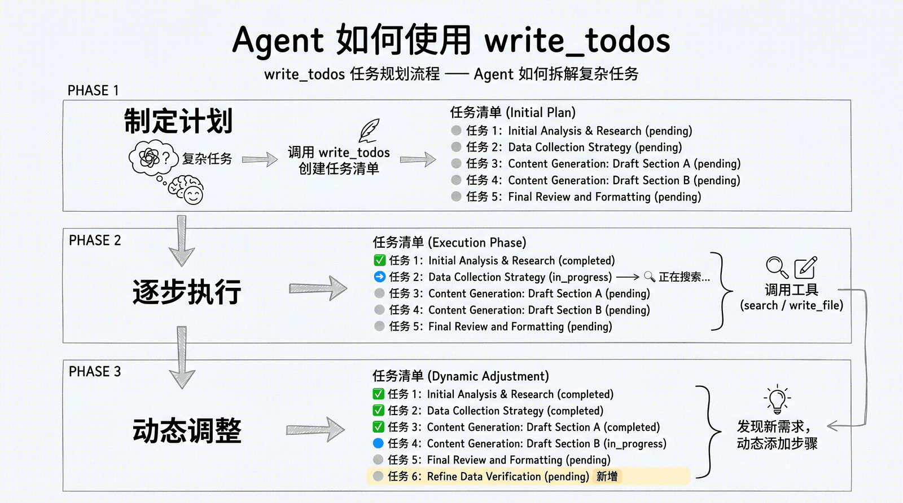

# 让项目按计划完成——TodoListMiddleware任务规划与分解

## 学习材料

https://datawhalechina.github.io/deepagents-in-action/chapters/ch04-task-planning/

## 核心概念

### 为什么 Agent 需要”规划”能力？

简单任务可以一步到位，复杂任务通常需要多步执行。**缺少明确的任务清单时，Agent 更容易遗漏步骤或重复搜索。**规划能力让 Agent 能够**先思考再行动**——把大任务拆解为小步骤，然后逐步执行、追踪进度、动态调整。

- **没有规划的 Agent 会怎样？**
  - **遗漏关键步骤**：直接开始写报告，忘了先搜索竞品信息
  - **重复劳动**：搜索了同一个关键词三次，因为它”忘记”已经搜过了
  - **半途而废**：上下文太长后，Agent 失去了对整体进度的把控
  - **质量不稳定**：有时做得很好，有时莫名跳过重要环节

### TodoListMiddleware启用原则

#### （1）原则

> v0.7开始版本需要显式启用任务规划。

| 场景                            | 建议                                   |
| ------------------------------- | -------------------------------------- |
| 单步问答、短工具调用            | 保持关闭，避免计划比任务本身还长       |
| 长程、多阶段、容易漏步骤的任务  | 启用，并用真实任务检查完成率和轨迹长度 |
| 能力较弱、容易失去主线的模型    | 先做 A/B 评测，通常值得尝试            |
| UI 需要展示计划、当前步骤和进度 | 启用；此时 `todos` 也是产品状态协议    |

#### （2）效果

- **启用后，DeepAgents 会获得 `write_todos` 工具，让 Agent 可以==创建和管理任务清单==**
- 工具存在不代表每个任务都会调用，具体行为仍由模型、提示词和任务复杂度共同决定

### 任务的数据结构与状态

- **数据结构**

每个任务包含以下字段：

```json
{
    "content": "搜索 LangGraph 官方文档，整理核心架构和 API 设计",  # 任务内容
    "status": "pending"  # 状态
}
```

- **三种状态**

| 状态          | 含义   | 典型场景                     |
| ------------- | ------ | ---------------------------- |
| `pending`     | 待办   | Agent 刚规划出来，还没开始做 |
| `in_progress` | 进行中 | Agent 正在执行这个步骤       |
| `completed`   | 已完成 | Agent 将任务标记为完成       |

常见状态流转：`pending` → `in_progress` → `completed`。模型也可以根据新信息调整清单，这不是框架强制执行的流程。

`completed` 是 Agent 写入的进度标记。**应用仍需检查产物**：例如报告是否生成、引用能否核实，或修改后的代码是否通过测试。**仅看清单全部完成，不能判断任务质量**。

### Agent 怎么用 write_todos？



### 任务清单的持久化

任务清单保存在 **Agent State 的 `todos` 字段**中，和消息历史分开管理：

- 同一次运行中，后续步骤可以继续访问这份清单；默认的对话总结不会删除 `todos` 字段
- 多次 `invoke()` 之间要自动接续清单，需要配置 Checkpointer，并复用同一个 `thread_id`；只添加 `TodoListMiddleware` 不会自动接续上次运行的状态
- `InMemorySaver` 只在当前进程中保存检查点；进程重启后还要恢复，需要使用数据库等持久化 Checkpointer。部署到 Agent Server 时，由平台提供相应的持久化能力
- 默认配置下，`general-purpose` 子 Agent 和 `subagents=[...]` 声明的子 Agent 都不会继承主 Agent 的 `TodoListMiddleware`。需要规划能力时，应在子 Agent 自己的 `middleware` 字段中启用
- 在默认的隔离模式下，子 Agent 的清单保存在自己的 `todos` 状态中，不会自动读取主 Agent 的清单，也不会将清单写回主 Agent

## Task3：复杂任务研究助手

### （1）示例代码

```python
import os
from langchain_openai import ChatOpenAI
from tavily import TavilyClient
from deepagents import create_deep_agent
from deepagents.backends import FilesystemBackend
from langchain.agents.middleware import TodoListMiddleware
from dotenv import load_dotenv
from pathlib import Path
from pydantic import SecretStr

load_dotenv(Path(__file__).resolve().parents[1] / ".env")

# virtual_mode=True 时，agent 看到的 /reports/xxx.md 落在本目录 reports/xxx.md。
reports_dir = Path(__file__).resolve().parent / "reports"
reports_dir.mkdir(parents=True, exist_ok=True)
backend = FilesystemBackend(
    root_dir=Path(__file__).resolve().parent,
    virtual_mode=True,
)

# 配置模型
model = ChatOpenAI(
    model=os.environ.get("OPENAI_MODEL", "deepseek-v4.1-flash"),
    api_key=SecretStr(os.environ["OPENAI_API_KEY"]),
    base_url=os.environ["OPENAI_BASE_URL"],
)

# 搜索工具
tavily_client = TavilyClient(api_key=os.environ["TAVILY_API_KEY"])

def internet_search(query: str, max_results: int = 5) -> dict:
    """搜索互联网获取最新信息。"""
    return tavily_client.search(query, max_results=max_results)

# 创建 Agent，并显式启用 write_todos
agent = create_deep_agent(
    model=model,
    tools=[internet_search],
    backend=backend,
    middleware=[TodoListMiddleware()],
    system_prompt="""你是一位专业的技术研究员。
面对复杂研究任务时，你会：
1. 先用 write_todos 制定研究计划
2. 逐步执行每个步骤，及时更新进度
3. 将搜索结果用 write_file 写入 /reports/ 目录整理
4. 最终把完整研究报告写入 /reports/harness_comparison_analysis.md
""",
)

# 发起一个需要规划的复杂任务
result = agent.invoke({
    "messages": [{
        "role": "user",
        "content": (
            "请调研 Agent 开发领域的三大 Harness 框架（DeepAgents、DSH、PiAgent），"
            "对比它们的核心能力差异，写一份专业详尽的分析报告，"
            "并用 write_file 保存到 /reports/harness_comparison_analysis.md。"
        ),
    }]
})

print(result["messages"][-1].content)

saved_file = reports_dir / "harness_comparison_analysis.md"
print(f"\n[磁盘验证] 文件已保存: {saved_file.exists()} (路径: {saved_file})")
if saved_file.exists():
    print(f"[磁盘内容前 200 字]:\n{saved_file.read_text()[:200]}")
```

### （2）执行结果

```bash
报告已完成并保存至 `/reports/harness_comparison_analysis.md`（545 行）。以下是核心内容摘要：

## 三大 Harness 框架对比要点

**一句话定位**

| 框架 | 定位 | 决策权归谁 |
|------|------|-----------|
| **DeepAgents** | 工具齐全、托管友好的工业级方案（LangGraph + 中间件栈） | 框架替你做决策 |
| **DSH** | 万物皆插件、可组合性极致（Cordis 元框架） | 你控制每一层 |
| **PiAgent** | 原语而非功能、可自生长的极简主义 | 你从最底层自己造 |

**架构核心差异**
- **DeepAgents**：基于 LangGraph 的"有主张"（opinionated）中间件栈——`create_deep_agent()` 一行内置 planning、虚拟文件系统、subagent委托、上下文压缩、记忆、技能、prompt 缓存。
- **DSH**：连 **Agent Loop 本身都是插件**。四种运行预设（Standard 干活 / PTC 编排 / Minimal 度量 / Creator 重塑），**6 种子代理提供器**（可桥接 Claude Code、Codex、ACP）——最大亮点是"跨产品编排"。
- **PiAgent**：默认只装 4 个工具（read/write/edit/bash），系统提示 **<1000 tokens**；不装子代理、MCP、计划模式。唯一内建的核心能力是**自修改**（用 TS 扩展改写自己的 Harness + `/reload`）。树状会话支持像 Git 一样分支。

**关键能力差异矩阵**（✓支持 / ○需扩展 / —不支持）
- 子代理：DeepAgents ✓ | DSH ✓（6 种）| Pi —
- 沙箱：DeepAgents ✓（Modal/Daytona/Deno）| DSH ✓（可替换）| Pi —（默认以用户权限运行）
- HITL：DeepAgents ✓ | DSH ✓ | Pi —
- 多语言 RPC：仅 Pi 原生支持

**实测数据（Composio 基准，DeepSeek V4 Flash）**
- Pi 通过率最高 **66.7%**，每成功任务成本最低 **$0.028**
- DeepAgents 53.3%；Claude Code 同为 53.3% 但成本高 4 倍以上
- 同模型跨 Harness 通过率差距可达 **20 个百分点**（68%→88%）——证明 Harness 是一阶变量
- 工具调用次数与结果非正相关：Grok Build 调用 402 次，Pi 仅 223 次，通过任务数相同

**选型决策树**
​```
需要托管 + 生产稳定 + 完整工具链      → DeepAgents
需要极致插件化 + 跨产品编排 + 可审计   → DSH
需要极简 + SDK 嵌入 + 多语言 RPC      → PiAgent
​```

**重要风险提示**：三者均为 MIT 开源，但 DSH 仍处 v0.1 Developer Preview（API 可能破坏性变更）；PiAgent 为个人维护且**默认无沙箱**；DeepAgents 强绑定 LangChain 生态。

报告含 11 个章节、4 张架构图、12 张对比表及全部参考资料链接。

[磁盘验证] 文件已保存: True (路径: /home/rzexin/.../reports/harness_comparison_analysis.md)
[磁盘内容前 200 字]:
# Agent 开发三大 Harness 框架对比分析报告

**调研对象：** DeepAgents（LangChain）、DSH / DeepSeek Harness（DeepSeek）、PiAgent / Pi Coding Agent（Earendil Works）
**报告定位：** 面向工程团队的技术选型与架构决策参考
**核心命题：** 在"模型趋于商品化、Harness 成为产品"
```

### （3）研究报告

[Agent开发三大Harness框架对比分析报告.md](./report/Agent开发三大Harness框架对比分析报告.md)