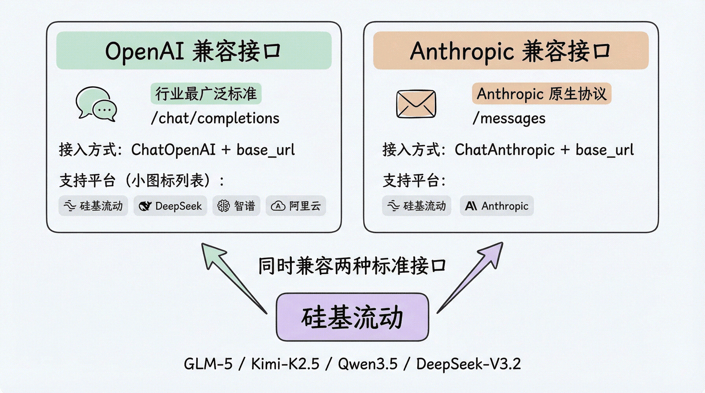
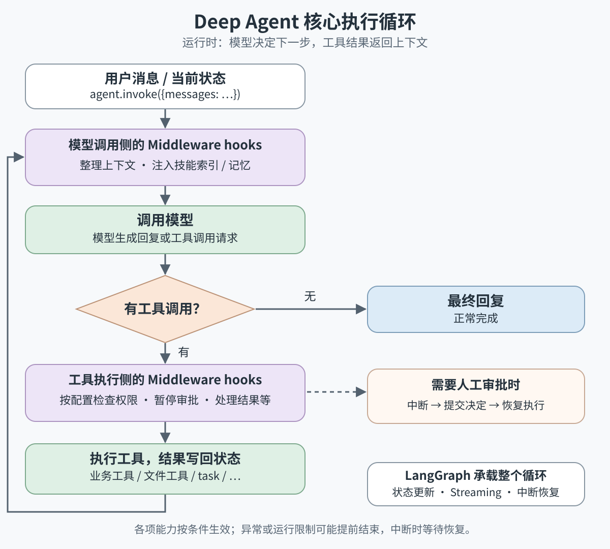
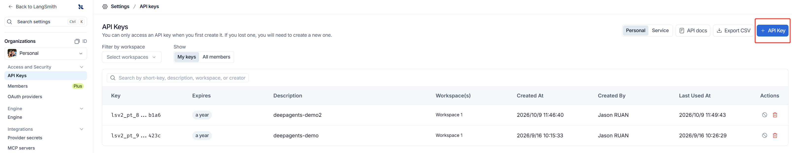
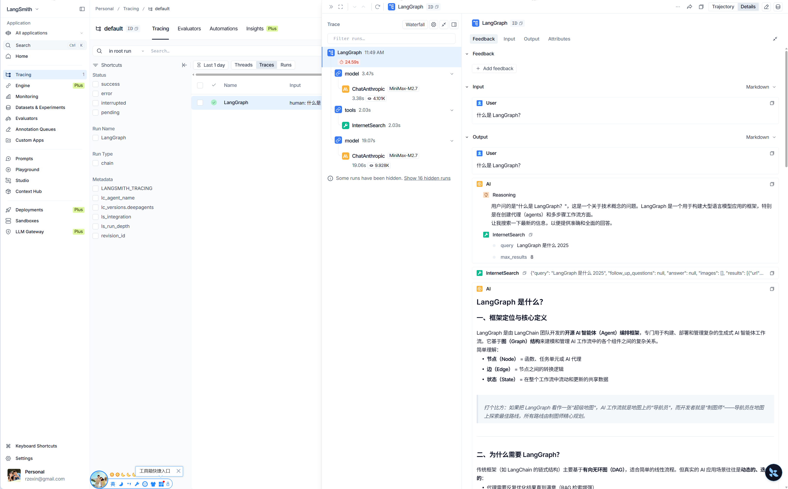
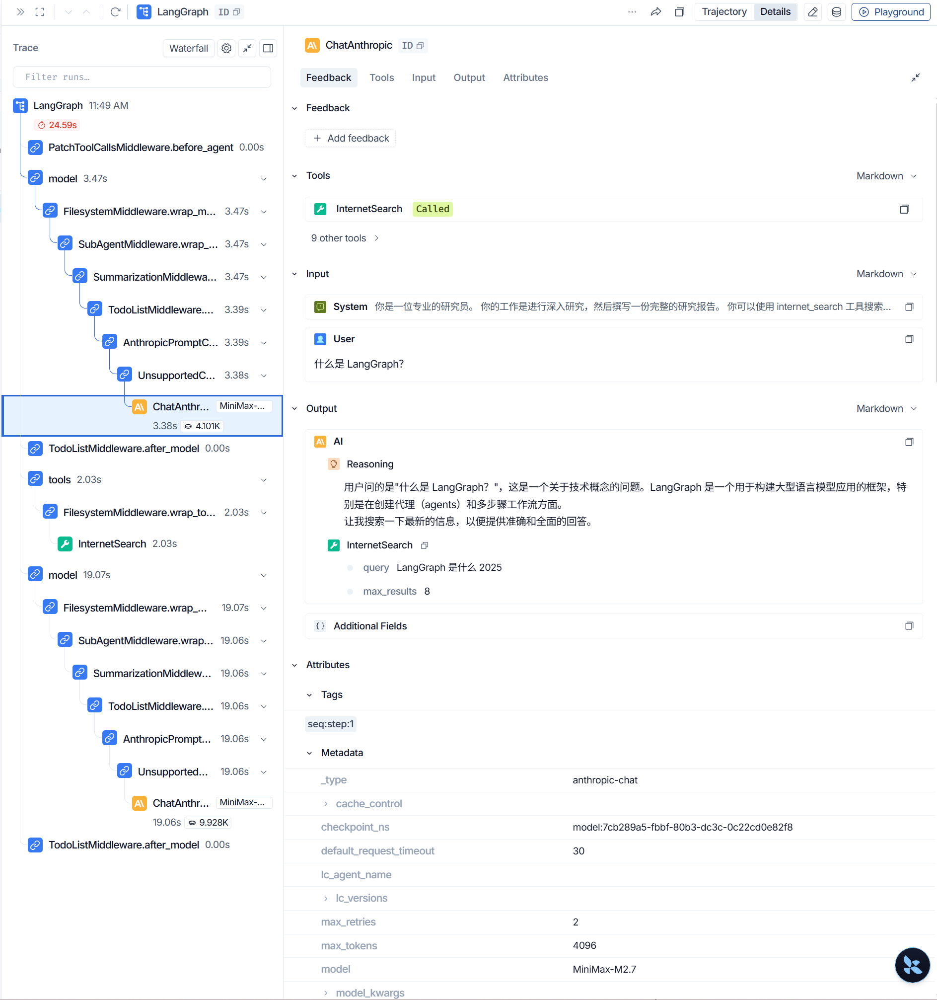
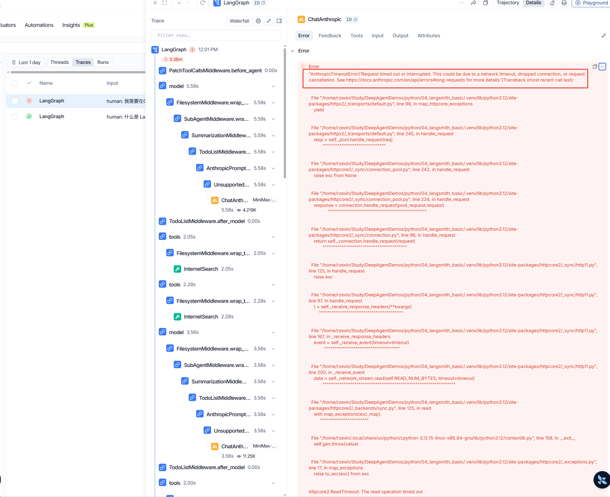

# Task1 快速上手——5 分钟构建你的第一个DeepAgent
## 学习材料

https://datawhalechina.github.io/deepagents-in-action/chapters/ch02-quickstart/

## 环境初始化

```bash
# 创建环境
❯ uv venv
Using CPython 3.12.15
Creating virtual environment at: .venv
Activate with: source .venv/bin/activate

# 激活环境
❯ source .venv/bin/activate

# 安装依赖
❯ uv pip install deepagents langchain-openai langchain-anthropic python-dotenv
```

## 两种大模型标准接口

- **OpenAI 兼容接口**（`/chat/completions`）：最广泛采用的标准，国内外绝大多数平台都兼容
- **Anthropic 兼容接口**（`/messages`）：Anthropic 的原生协议，部分平台也提供兼容



## 核心执行循环




## 示例1：天气Agent

### （1）OpenAI兼容接口示例代码

```python
import os
from pathlib import Path

from dotenv import load_dotenv
from langchain_openai import ChatOpenAI
from deepagents import create_deep_agent
from pydantic import SecretStr

load_dotenv(Path(__file__).resolve().parent / ".env")

# 通过硅基流动接入模型（兼容 OpenAI 接口）
model = ChatOpenAI(
    # 当前免费模型，可用 MODEL_NAME 环境变量覆盖（如付费的 zai-org/GLM-5.2）
    model=os.environ.get("OPENAI_MODEL", "deepseek-v4.1-flash"),
    api_key=SecretStr(os.environ["OPENAI_API_KEY"]),
    base_url=os.environ["OPENAI_BASE_URL"],
)

def get_weather(city: str) -> str:
    """Get weather for a given city."""
    return f"It's always sunny in {city}!"

agent = create_deep_agent(
    model=model,
    tools=[get_weather],
    system_prompt="You are a helpful assistant.",
)

result = agent.invoke(
    {"messages": [{"role": "user", "content": "北京今天天气怎么样？"}]}
)

print(result["messages"][-1].content)
```

### （2）Anthropic兼容接口示例代码

```ts
import os
from pathlib import Path

from dotenv import load_dotenv
from langchain_anthropic import ChatAnthropic                      # <----- 修改
from deepagents import create_deep_agent
from pydantic import SecretStr

load_dotenv(Path(__file__).resolve().parent / ".env")

model = ChatAnthropic(
    model_name=os.environ.get("ANTHROPIC_MODEL", "MiniMax-M2.7"),  # <----- 修改 
    api_key=SecretStr(os.environ["ANTHROPIC_API_KEY"]),
    base_url=os.environ["ANTHROPIC_BASE_URL"],
    timeout=30,                                                    # <----- 修改
    stop=["\n\n"],                                                 # <----- 修改
)

def get_weather(city: str) -> str:
    """Get weather for a given city."""
    return f"It's always sunny in {city}!"

agent = create_deep_agent(
    model=model,
    tools=[get_weather],
    system_prompt="You are a helpful assistant.",
)

result = agent.invoke(
    {"messages": [{"role": "user", "content": "北京今天天气怎么样？"}]}
)

# Anthropic 的 content 是内容块列表（thinking / text），.text 只拼接 type=text 的正文
print(result["messages"][-1].text.strip())                         # <----- 修改
```

### （3）运行结果

```bash
❯ python hello_weather_openai.py
北京今天天气不错——**晴天**！☀️

如果你有出行计划，可以放心安排户外活动，不过也别忘了做好防晒哦。需要我帮你查点别的吗？


❯ python hello_weather_anthropic.py 
根据查询结果，北京今天的天气是**阳光明媚**！☀️

不过需要注意的是，这个查询结果可能比较简略。如果你需要更详细的天气信息（如温度、湿度、空气质量等），建议查看专业的天气预报应用或网站。

请问还有什么我可以帮您的吗？
```

## 示例2：计算器Agent

### （1）示例代码

```python
import os
from pathlib import Path

from dotenv import load_dotenv
from langchain_anthropic import ChatAnthropic
from deepagents import create_deep_agent
from pydantic import SecretStr

load_dotenv(Path(__file__).resolve().parent / ".env")

model = ChatAnthropic(
    model_name=os.environ.get("ANTHROPIC_MODEL", "MiniMax-M2.7"),
    api_key=SecretStr(os.environ["ANTHROPIC_API_KEY"]),
    base_url=os.environ["ANTHROPIC_BASE_URL"],
    timeout=30,
    stop=["\n\n"],
)

def calculate(expression: str) -> float:
    """Evaluate a math expression and return the result.

    Args:
        expression: A math expression, e.g. "1 + 2 * 3".
    """
    # 仅做演示，实际项目应使用安全的解析库而非 eval
    return eval(expression)

def convert_currency(amount: float, from_currency: str, to_currency: str = "CNY") -> dict:
    """Convert an amount from one currency to another.

    Args:
        amount: The amount to convert.
        from_currency: The source currency code, e.g. "USD".
        to_currency: The target currency code, defaults to "CNY".
    """
    # 这里用固定汇率做演示；真实场景可接入汇率 API
    rates = {"USD": 6.7, "CNY": 1.0, "EUR": 7.5}
    cny = amount * rates[from_currency]
    return {"amount": round(cny / rates[to_currency], 2), "currency": to_currency}

agent = create_deep_agent(
    model=model,
    tools=[calculate, convert_currency],
    system_prompt="你是一个计算助手，能帮用户做数学运算和货币换算。",
)

result = agent.invoke(
    {"messages": [{"role": "user", "content": "帮我把 100 美元换算成人民币，再用它乘以 1.08 的通胀系数。"}]}
)

print(result["messages"][-1].text.strip())
```

### （2）运行结果

```bash
❯ python calculate.py 
换算结果如下：

| 步骤 | 计算 | 结果 |
|------|------|------|
| 1. 美元 → 人民币 | 100 USD | **670.00 CNY** |
| 2. 乘以通胀系数 | 670 × 1.08 | **723.60 CNY** |

**最终结果：100 美元 × 1.08 通胀系数 = 723.6 元人民币**
```

## 示例3：研究助手Agent

### （1）示例代码

- **internet_search.py**

```python
import os
from pathlib import Path
from typing import Literal

from dotenv import load_dotenv
from tavily import TavilyClient

load_dotenv(Path(__file__).resolve().parent / ".env")

tavily_client = TavilyClient(api_key=os.environ["TAVILY_API_KEY"])

def InternetSearch(
    query: str,
    max_results: int = 5,
    topic: Literal["general", "news", "finance"] = "general",
    include_raw_content: bool = False,
):
    """Run a web search for the given query.

    Args:
        query: The search query string.
        max_results: Maximum number of results to return.
        topic: The topic category for the search.
        include_raw_content: Whether to include raw page content.
    """
    return tavily_client.search(
        query,
        max_results=max_results,
        include_raw_content=include_raw_content,
        topic=topic,
    )
```

- **research.py**

```python
import os
from pathlib import Path

from dotenv import load_dotenv
from langchain_anthropic import ChatAnthropic
from deepagents import create_deep_agent
from pydantic import SecretStr
from langchain.agents.middleware import TodoListMiddleware

from internet_search import InternetSearch

load_dotenv(Path(__file__).resolve().parent / ".env")

model = ChatAnthropic(
    model_name=os.environ.get("ANTHROPIC_MODEL", "MiniMax-M2.7"),
    api_key=SecretStr(os.environ["ANTHROPIC_API_KEY"]),
    base_url=os.environ["ANTHROPIC_BASE_URL"],
    timeout=30,
    stop=["\n\n"],
)

research_instructions = """你是一位专业的研究员。
你的工作是进行深入研究，然后撰写一份完整的研究报告。

你可以使用 internet_search 工具搜索互联网获取信息。
"""

agent = create_deep_agent(
    model=model,
    tools=[InternetSearch],
    system_prompt=research_instructions,
    middleware=[TodoListMiddleware()],
)

result = agent.invoke(
    {"messages": [{"role": "user", "content": "什么是 LangGraph？"}]}
)

print(result["messages"][-1].text.strip())

```

### （2）运行结果 

```
❯ python research.py 
## LangGraph 是什么？

LangGraph 是由 LangChain 团队开发的一个开源框架，专门用于构建**有状态、多参与者的 AI Agent 工作流**。它是 LangChain 生态系统的重要组成部分，但也可以独立使用。

### 核心概念

LangGraph 将 AI 工作流建模为**有向图（Directed Graph）**，主要由三部分组成：

- **节点（Node）**：代表工作流中的各个执行单元，比如 LLM 调用、工具执行或自定义逻辑
- **边（Edge）**：定义节点之间的流转路径，支持条件分支判断
- **状态（State）**：在整个工作流中共享和传递的数据

### 核心特点

1. **循环与分支控制**：支持在应用中实现循环和条件判断，这对 Agent 架构至关重要
2. **持久化**：在图的每个步骤自动保存状态，支持暂停、恢复和时间旅行（回溯到历史状态）
3. **人工介入**：可以在执行过程中插入人工审核和干预
4. **流式支持**：支持 token 级别的流式输出
5. **与 LangChain 无缝集成**：可使用 LangChain 的全部功能

### 与传统框架的区别

传统的工作流框架（如 LangChain）通常基于 **DAG（有向无环图）**，无法处理需要循环的场景。LangGraph 突破了这一限制，支持**循环图**，能更好地模拟真实业务中的迭代需求，比如让 AI Agent反复优化查询结果直到满意为止。

### 应用场景

- 构建自主 Agent（如客服自动化、代码生成）
- 多步骤复杂工作流编排
- 需要人工审核的决策流程（如医疗诊断辅助）
- 多 Agent 协作系统

### 简单示例

一个典型的 LangGraph Agent 工作流程可以理解为：
1. 调用 LLM 决定下一步操作
2. 执行相应操作
3. 返回步骤 1 重复，直到生成最终响应

这种循环机制使 AI 能够处理更复杂、更灵活的任务。

---

**总结**：LangGraph 是一个强大的 Agent 编排框架，特别适合需要循环推理、状态管理和人机协作的复杂 AI 应用场景。它已被 Uber、Klarna 等企业用于生产环境。
```

## Task1： 我的第一个工具Agent——美文生成器

### （1）美文生成器Agent代码

```python
import os
import sys
from pathlib import Path

from dotenv import load_dotenv
from langchain_core.messages import HumanMessage, SystemMessage
from langchain_openai import ChatOpenAI
from pydantic import SecretStr

load_dotenv(Path(__file__).resolve().parent / ".env")
load_dotenv(Path(__file__).resolve().parents[1] / ".env")

model = ChatOpenAI(
    model=os.environ.get("OPENAI_MODEL", "deepseek-v4.1-flash"),
    api_key=SecretStr(os.environ["OPENAI_API_KEY"]),
    base_url=os.environ["OPENAI_BASE_URL"],
)

system_prompt = """你是一位中文散文作者。用户只给你一句平常的话，你把它写成一段美文。

要求：
- 只输出这一段正文，不要标题、引号、解释或分点。
- 保留原句的意思，不另编情节，不添加原句里没有的具体事实。
- 不要把用户的原句单独复述出来，把意思化进叙述里。
- 120 到 180 字，一段到底。
- 从一个具体的画面写起，再轻轻转到一句让人停一下的道理。
- 句子要顺，少用排比和成语堆砌，不要写成鸡汤口号。
"""


def render(sentence: str) -> str:
    """Turn one plain sentence into a short reflective paragraph."""
    message = model.invoke(
        [
            SystemMessage(content=system_prompt),
            HumanMessage(content=sentence),
        ]
    )
    content = message.content
    if isinstance(content, list):
        content = "".join(
            block.get("text", "") if isinstance(block, dict) else str(block)
            for block in content
        )
    return str(content).strip()


if __name__ == "__main__":
    sentence = " ".join(sys.argv[1:]).strip() or "今天加班到很晚"
    print(render(sentence))
```

### （2）运行结果

- **默认**

```bash
$ uv run python prose.py 
屏幕的光在桌面上亮着，窗外早从灰蓝沉成墨色。键盘声停下的那一刻，才发觉周围安静得只剩空调的风。我合上电脑，穿过走廊，灯光把影子拉长又收回脚下。夜风迎面，凉意让人清醒。有些日子被工作一寸寸填满，等抬头，时间已走到很深的夜里。疲惫是真的，不必把它说成勋章，也不必向谁解释；它只是生活经过时留下的一点重量。走慢些，让呼吸跟上脚步，让此刻的安静，替今天轻轻收尾。

$ uv run python prose.py 周末去北京
窗外的景色一帧帧向后退去，从灰色的楼群换成辽阔的田野，再到远山淡淡的轮廓。手机里还开着没回完的消息，背包搁在膝上，轻轻颠着。列车向前，像是把平日里那些拧紧的东西一圈圈松开了。其实去哪里并不重要，重要的是有一个周末，愿意把自己从惯常的轨道上摘下来，交给一段没有任务的时光。北京这两个字，此刻更像一个出口，一个让人暂时可以对所有琐事说“等等”的理由。人不总是需要抵达的，有时候，光是出发，就已经是歇息了。
```


## 接入LangSmith

> 当 Agent 的行为不符合预期时，你需要看到它“内部在想什么”。LangSmith 是 LangChain 的可观测性平台，可以记录 Agent 的每一次模型调用、工具调用和状态变化。

### （1）注册LangSmith，创建API KEY

https://www.langchain.com/langsmith-platform



### （2）新增环境变量

> 设置好环境变量后，无需修改任何代码，你的 Agent 运行记录就会自动上传到 LangSmith。

```bash
LANGSMITH_TRACING=true
LANGSMITH_API_KEY=lsv2_pt_8d......8cb1a6
```

### （3）LangSmith面板查看

> 在 LangSmith 的 Trace 面板中，你可以看到：
>
> - Agent 的完整决策链路（每次模型调用的输入/输出）
> - 工具调用的参数和返回值
> - 子 Agent 的执行过程
> - 每一步的 token 消耗和耗时
> - 虚拟文件系统中文件的变化
>
> 这对于理解“Agent 为什么做了这个决定”至关重要，尤其是在调试复杂的多步骤任务时。

- **正常日志**





- **异常日志**



## 附录

### （1）OpenAI响应协议

>  **OpenAI 风格（tool_calls + finish_reason + prompt/completion_tokens）**

```json
[
  {
    "type": "HumanMessage",
    "content": "北京今天天气怎么样？",
    "additional_kwargs": {},
    "response_metadata": {},
    "id": "c68e55f3-52c7-4571-b13a-fabd08475a4d"
  },
  {
    "type": "AIMessage",
    "content": "",
    "additional_kwargs": {
      "refusal": null
    },
    "response_metadata": {
      "token_usage": {
        "completion_tokens": 54,
        "prompt_tokens": 2794,
        "total_tokens": 2848,
        "completion_tokens_details": {
          "accepted_prediction_tokens": null,
          "audio_tokens": null,
          "reasoning_tokens": 15,
          "rejected_prediction_tokens": null,
          "text_tokens": null
        },
        "prompt_tokens_details": {
          "audio_tokens": null,
          "cache_write_tokens": null,
          "cached_tokens": 2688,
          "image_tokens": null,
          "text_tokens": null
        }
      },
      "model_provider": "openai",
      "model_name": "deepseek-v4-1-flash-260910",
      "system_fingerprint": null,
      "id": "0217915131520113b1efaefedc80320ce9d044f8a4375a980ac70",
      "service_tier": "default",
      "finish_reason": "tool_calls",
      "logprobs": null
    },
    "id": "lc_run--01a11e81-4b5d-77e2-b755-80d23e8f6bd3-0",
    "tool_calls": [
      {
        "name": "get_weather",
        "args": {
          "city": "北京"
        },
        "id": "call_00_hfhza25wr0yx4yahysap0b98",
        "type": "tool_call"
      }
    ],
    "invalid_tool_calls": [],
    "usage_metadata": {
      "input_tokens": 2794,
      "output_tokens": 54,
      "total_tokens": 2848,
      "input_token_details": {
        "cache_read": 2688
      },
      "output_token_details": {
        "reasoning": 15
      }
    }
  },
  {
    "type": "ToolMessage",
    "content": "It's always sunny in 北京!",
    "name": "get_weather",
    "id": "d00808de-af90-48f9-837d-6ead011702d8",
    "tool_call_id": "call_00_hfhza25wr0yx4yahysap0b98"
  },
  {
    "type": "AIMessage",
    "content": "北京今天天气是晴天（\"It's always sunny in 北京!\"）——不过这个天气工具返回的是一句固定的答复，没有给出具体的温度和湿度等信息。如果你需要精确的天气数据，建议查看中国天气网或手机自带的天气应用。",
    "additional_kwargs": {
      "refusal": null
    },
    "response_metadata": {
      "token_usage": {
        "completion_tokens": 78,
        "prompt_tokens": 2852,
        "total_tokens": 2930,
        "completion_tokens_details": {
          "accepted_prediction_tokens": null,
          "audio_tokens": null,
          "reasoning_tokens": 23,
          "rejected_prediction_tokens": null,
          "text_tokens": null
        },
        "prompt_tokens_details": {
          "audio_tokens": null,
          "cache_write_tokens": null,
          "cached_tokens": 2816,
          "image_tokens": null,
          "text_tokens": null
        }
      },
      "model_provider": "openai",
      "model_name": "deepseek-v4-1-flash-260910",
      "system_fingerprint": null,
      "id": "0217915131538423b1efaefedc80320ce9d044f8a4375a9baf914",
      "service_tier": "default",
      "finish_reason": "stop",
      "logprobs": null
    },
    "id": "lc_run--01a11e81-5326-7100-a08d-05d7857d6af6-0",
    "tool_calls": [],
    "invalid_tool_calls": [],
    "usage_metadata": {
      "input_tokens": 2852,
      "output_tokens": 78,
      "total_tokens": 2930,
      "input_token_details": {
        "cache_read": 2816
      },
      "output_token_details": {
        "reasoning": 23
      }
    }
  }
]
```


### （2）Anthropic响应协议

>  **Anthropic 风格（content blocks + thinking + stop_reason）**

```json
[
  {
    "type": "HumanMessage",
    "content": "北京今天天气怎么样？",
    "additional_kwargs": {},
    "response_metadata": {},
    "id": "0d3039c6-0612-44d6-8ee3-3435b984bca4"
  },
  {
    "type": "AIMessage",
    "content": [
      {
        "signature": "dd7741cbd10f3f74dad6297e791cb0bec860ba21968d84caf6f6083a7dee5a84",
        "thinking": "用户问北京今天的天气怎么样，我可以使用 get_weather 工具来查询。\n",
        "type": "thinking"
      },
      {
        "id": "chatcmpl-tool-85fc70aa6271196f",
        "input": {
          "city": "北京"
        },
        "name": "get_weather",
        "type": "tool_use",
        "toolset_name": null
      }
    ],
    "additional_kwargs": {},
    "response_metadata": {
      "id": "0717839fa4bd858eb10c7489f388e149",
      "container": null,
      "diagnostics": null,
      "model": "MiniMax-M2.7",
      "stop_details": null,
      "stop_reason": "tool_use",
      "stop_sequence": null,
      "usage": {
        "cache_creation": null,
        "cache_creation_input_tokens": 0,
        "cache_read_input_tokens": 0,
        "inference_geo": null,
        "input_tokens": 2626,
        "output_tokens": 43,
        "output_tokens_details": null,
        "server_tool_use": null,
        "service_tier": null
      },
      "base_resp": {
        "status_code": 0,
        "status_msg": ""
      },
      "model_name": "MiniMax-M2.7",
      "model_provider": "anthropic"
    },
    "id": "lc_run--01a11e7a-ef19-7652-9524-7c5927cb64ae-0",
    "tool_calls": [
      {
        "name": "get_weather",
        "args": {
          "city": "北京"
        },
        "id": "chatcmpl-tool-85fc70aa6271196f",
        "type": "tool_call"
      }
    ],
    "invalid_tool_calls": [],
    "usage_metadata": {
      "input_tokens": 2626,
      "output_tokens": 43,
      "total_tokens": 2669,
      "input_token_details": {
        "cache_read": 0,
        "cache_creation": 0
      }
    }
  },
  {
    "type": "ToolMessage",
    "content": "It's always sunny in 北京!",
    "name": "get_weather",
    "id": "44a074a0-b311-40d7-9422-7ff66fd811f7",
    "tool_call_id": "chatcmpl-tool-85fc70aa6271196f"
  },
  {
    "type": "AIMessage",
    "content": [
      {
        "signature": "b8e64f63c0a7b664b3739b7bfa245c1a27e2cd7c1a6ce2c27d7e740e1dc416ad",
        "thinking": "查询结果返回说北京今天天气总是阳光明媚。这是一个模拟的返回结果。让我向用户报告这个结果。\n",
        "type": "thinking"
      },
      {
        "text": "\n根据查询结果，北京今天的天气是**晴天**，阳光明媚！☀️\n\n不过需要说明的是，这个结果是从天气工具获取的模拟数据。如果您需要了解北京实时的准确天气情况，建议您查看专业的天气预报网站或应用（如中国气象局官网、墨迹天气等）。\n\n如果您有其他需要帮助的事情，欢迎随时告诉我！",
        "type": "text"
      }
    ],
    "additional_kwargs": {},
    "response_metadata": {
      "id": "071783a0b019a1c11d06387acedb9c1a",
      "container": null,
      "diagnostics": null,
      "model": "MiniMax-M2.7",
      "stop_details": null,
      "stop_reason": "end_turn",
      "stop_sequence": null,
      "usage": {
        "cache_creation": null,
        "cache_creation_input_tokens": 0,
        "cache_read_input_tokens": 2512,
        "inference_geo": null,
        "input_tokens": 159,
        "output_tokens": 93,
        "output_tokens_details": null,
        "server_tool_use": null,
        "service_tier": null
      },
      "base_resp": {
        "status_code": 0,
        "status_msg": ""
      },
      "model_name": "MiniMax-M2.7",
      "model_provider": "anthropic"
    },
    "id": "lc_run--01a11e7a-f4eb-7522-acb7-5d0f7dc9c563-0",
    "tool_calls": [],
    "invalid_tool_calls": [],
    "usage_metadata": {
      "input_tokens": 2671,
      "output_tokens": 93,
      "total_tokens": 2764,
      "input_token_details": {
        "cache_read": 2512,
        "cache_creation": 0
      }
    }
  }
]
```

### （3）协议差异

| 对比维度               | 第一次                                  | 第二次                                        |
| :--------------------- | :-------------------------------------- | :-------------------------------------------- |
| 模型                   | MiniMax-M2.7（anthropic provider）      | deepseek-v4-1-flash-260910（openai provider） |
| AIMessage 的 `content` | 结构化数组（含 thinking / tool_use 块） | 空字符串 `""`，工具调用走 `tool_calls` 字段   |
| 是否暴露思维链         | 是（`thinking` 块显式写出）             | 否（仅有 `reasoning_tokens` 计数，无文本）    |
| `finish_reason` 位置   | `stop_reason: "tool_use"`               | `finish_reason: "tool_calls"`                 |
| token 统计字段         | `usage` + `usage_metadata`              | `token_usage` + `usage_metadata`              |
| 工具调用 ID 格式       | `chatcmpl-tool-...`                     | `call_00_...`                                 |
| 最终回答风格           | 补充免责说明、推荐专业渠道              | 指出工具返回是「固定答复」、缺具体数据        |